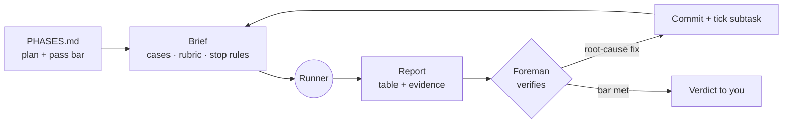

<p align="center">
  
</p>

<h1 align="center">delegate</h1>

<p align="center">
  <em>The worker gathers. You judge.</em>
</p>

<p align="center">
  
  
  
</p>

---

You know the Foreman. Hard hat, reading glasses, clipboard. He doesn't run the test suite himself. He writes down what "pass" means, sends the runner, opens two screenshots, and finds the one number that's wrong.

**delegate** turns Claude into the Foreman. A cheaper model does the legwork: test runs, browser QA, eval rounds, data pulls. Your strongest model keeps every judgement: the plan, the expected answers, the grading, the fixes and the final verdict.

You get the cost of a small model and the judgement of a big one. Results don't get worse, because nothing the runner reports is accepted unchecked.

## Who does what

| 🤖 The runner (Sonnet, low effort) | 🦉 The Foreman (your main model) |
|---|---|
| Runs tests, builds and lint | Scopes the work and writes `PHASES.md` |
| Drives the browser, takes screenshots, times responses | Decides the expected answer for every case |
| Sends eval prompts and records raw outputs | Sets the rubric and the pass bar |
| Pulls ground truth from APIs and databases | Spot-checks evidence and re-grades borderline calls |
| Makes mechanical, fully specified edits | Finds root causes and fixes them, one commit per fix |
| | Reviews any code touching money, auth or data loss line by line |
| | Gives you the verdict |

## Install

```bash
claude plugin marketplace add Solomon-mithra/delegate
claude plugin install delegate@delegate
```

Or inside a session: `/plugin marketplace add Solomon-mithra/delegate`, then `/plugin install delegate@delegate`.

<details>
<summary>Manual install (no plugin system)</summary>

```bash
git clone https://github.com/Solomon-mithra/delegate.git
cp -R delegate/skills/delegate ~/.claude/skills/
```

</details>

## Try it

Say "delegate", or describe work you want supervised rather than done by hand.

```text
Delegate the eval: run the 44 questions in evals/qs.json against staging.
Sonnet at low effort runs them, you grade against the API.
```

```text
Have a subagent run the full test suite and lint. You only monitor.
Fix whatever breaks, one commit per fix.
```

```text
Hand browser QA of the checkout flow to haiku. I want screenshots of
every step at 375px and 1440px, and the time from click to confirmation.
```

```text
Keep running eval rounds until correctness is at least 42/44 and replies
stay under 40 words. Delegate the runs; the fixes are yours.
```

```text
Delegate pulling last month's transactions from the API into
/tmp/ground-truth.json, then use it to check the dashboard totals.
```

## The loop



1. **Plan first.** Every job gets a `PHASES.md` of phases and subtasks, each one commit. Progress survives context resets. Here's the [template](skills/delegate/references/phases-template.md).
2. **Brief cold.** The runner sees none of your conversation, so each brief stands on its own: goal, hard limits, exact setup, cases, rubric, the last round's failures, and when to stop.
3. **Run in the background.** The Foreman keeps fixing code while the round runs. He doesn't poll and doesn't guess at results.
4. **Verify.** He opens the screenshots, re-runs the key command, catches measurement artifacts, and re-grades against ground truth. His grade wins.
5. **Fix and repeat.** He fixes root causes rather than symptoms, re-runs the same cases, and stops when the bar is met or when another round would only measure model variance.

## What you get back

```text
Verdict: 42/44 correct (was 37). Two failures left, both date-range questions.

| Round | Change under test        | Correct | Words p50 | Latency p50 |
|-------|--------------------------|---------|-----------|-------------|
| 1     | baseline                 | 37/44   | 61        | 4.1 s       |
| 2     | precomputed totals field | 41/44   | 38        | 3.2 s       |
| 3     | sentence-boundary cap    | 42/44   | 34        | 3.0 s       |

Caveat: round 1 latency measured the user bubble, not the reply. Corrected above.
Committed: F494 (621f3f3), F495 (8c0d1aa). Not pushed.
```

## Tuning

Name a different model or effort level in your prompt ("delegate to haiku", "sonnet at medium effort") and the runner uses it. The default is Sonnet at low effort.

## License

[MIT](LICENSE)
